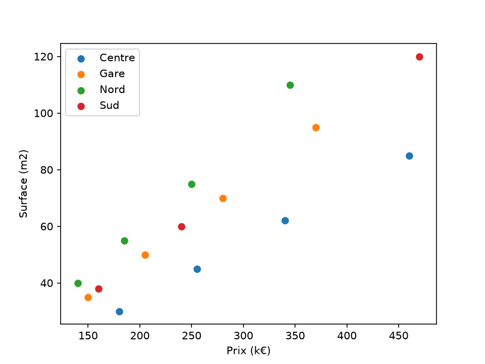

# cours_data 🏠📊

🇬🇧 English | [🇫🇷 Français](README.fr.md)

My learning path through **NumPy, pandas, matplotlib and scikit-learn**, ending with a small data science project: **predicting apartment prices**.

> Follow-up to [mini_sklearn](https://github.com/PaulBrochot/mini_sklearn), where I coded a tiny machine learning library in pure Python. Here, I use the real tools.

---

## Final project: predicting the price of an apartment

📓 Notebook: [`projet.ipynb`](projet.ipynb)

### The question

Can we predict the price of an apartment from its surface area? And does the neighborhood matter?

### The steps

1. **Load and clean** the data: remove duplicates, drop rows with no price, fill missing floors with the median, add a price per m² column (17 rows → 15 clean apartments)
2. **Explore**: median price, most and least expensive neighborhoods per m², filtering
3. **Visualize**: price vs. surface, colored by neighborhood
4. **Model with surface only**: `LinearRegression` from scikit-learn, compared to a baseline that always predicts the average price
5. **Add the neighborhood**: one-hot encoding with `pd.get_dummies`
6. **Conclude**

### Price vs. surface, by neighborhood



At equal surface, apartments in the Centre are consistently more expensive, and those in the Nord cheaper.

### Results

Mean absolute error on the test set (5 apartments, `random_state=42`):

| Model | Mean error (k€) |
|---|---|
| Average (baseline) | 79.5 |
| Surface only | 48.5 |
| Surface + neighborhood | **19.5** |

### Conclusion

Adding the surface lowers the error from 79.5 to 48.5 k€, and adding the neighborhood lowers it further to 19.5 k€. The neighborhood carries almost as much information as the surface and **cuts the error by more than half**.

⚠️ **Limitation:** these numbers rely on only 15 apartments, 5 of them in the test set. With a different split, the errors could change significantly. A reliable conclusion would require much more data, or cross-validation.

---

## The course, chapter by chapter

| Notebook | Topic |
|---|---|
| `chapitre1.ipynb` | NumPy arrays: shape, dtype, vectorization |
| `chapitre2.ipynb` | Selection, boolean masks, aggregations, random numbers |
| `chapitre3.ipynb` | Rewriting part of mini_sklearn with NumPy (error, train/test split, linear regression) |
| `chapitre4.ipynb` | pandas: Series, DataFrame, `read_csv` |
| `chapitre5.ipynb` | `loc` / `iloc`, filters, `isin` |
| `chapitre6.ipynb` | Data cleaning: missing values, duplicates, types |
| `chapitre7.ipynb` | `groupby`, `agg`, sorting |
| `chapitre8.ipynb` | Visualization with matplotlib |

> Note: notebooks, variables and comments are in French, as I learned in French.

---

## Installation

```bash
git clone https://github.com/PaulBrochot/cours_data.git
cd cours_data
python3 -m venv .venv
source .venv/bin/activate
pip install -r requirements.txt
```

Then open the notebooks in VS Code or Jupyter.

---

## What I learned

- Thinking in **vectors** instead of loops (NumPy)
- Loading, cleaning, filtering and aggregating tables (pandas)
- Making readable charts (matplotlib)
- Training and evaluating a model with scikit-learn: `train_test_split`, `fit`, `predict`, `mean_absolute_error`
- Encoding text categories as numbers (one-hot encoding)
- Always comparing a model to a **baseline**, and never letting the test set leak into training
- Staying cautious about conclusions drawn from small datasets
